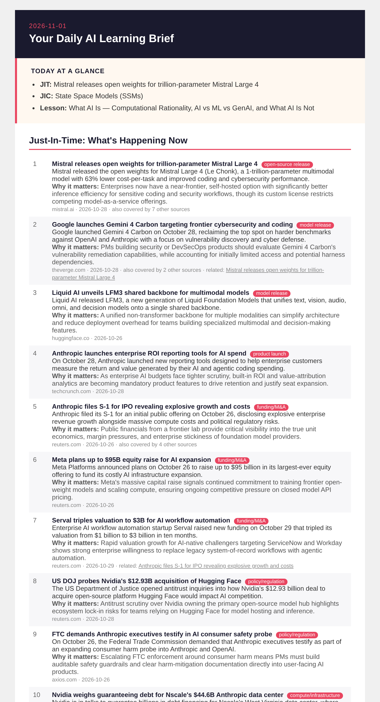
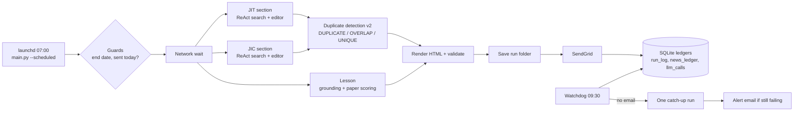

# Daily JIT/JIC AI Newsletter

**An autonomous AI pipeline that emails me a focused AI briefing every morning at 7:00. It was built test-first and is governed like a product.**

-brightgreen)




---

## Why this exists

AI moves faster than any single feed can track. I was reading reactively across a dozen sources every morning, with no way to separate what was trending from the concepts underneath it.

**The job to be done:** replace an hour of scattered reading with about 10 focused minutes, with no manual effort once it is running.

## What it delivers each morning

| Section | What it is | How it is chosen |
|---|---|---|
| **JIT (Just-In-Time)** | 5 to 10 AI developments from the last 7 days | ReAct research agent plus first-party searches. An editor model picks only from real search results, across at least 4 categories. |
| **JIC (Just-In-Case)** | 5 to 10 foundational concepts discussed in the last 14 days | Research-grounded search from trusted tiers. At least 4 buckets, and at most 2 items from media sources. |
| **Daily lesson** | One topic from an 88-topic curriculum: Foundations, then Build & Agents, then PM | The next topic in `config/topic_pool.json`, written into fixed slots (below) |

**Lesson slots:** TL;DR (3 sentences) · 3A What it is (definition, components, how it works, equation, examples, limits) · 3C Key papers (up to 5, verified) · 3D Where it applies (3 uses plus a PM guide) · 3E Maturity · 3H What next (3 sourced directions) · 3I Glossary (8 to 12 terms).

**Quiet days are allowed.** If fewer than 5 new stories pass the checks, the email says so. Repeats are never used to fill space.

---

## How it works



| Layer | Tool | Notes |
|---|---|---|
| Scheduler | macOS `launchd`: pipeline at 07:00, watchdog at 09:30. `pmset` wakes the Mac at 06:55. | `--scheduled` never sends twice a day and stops after `SCHEDULE_END_DATE` |
| Models | Vertex AI Gemini 4 Argon (medium thinking), falling back to Gemini 3.8 Flash, via LiteLLM | Retries 429/5xx/timeouts twice with backoff and fails fast on 4xx. Truncated, blocked or empty output counts as an error. Hard daily cost cap. |
| Search | Tavily, then Exa, then DuckDuckGo | Registry allow-list (`config/source_registry.json`), date windows, logged drop reasons. Exa tops up when Tavily keeps too few. |
| Duplicates | Gemini embeddings (`SEMANTIC_SIMILARITY`) plus an editor-written story fingerprint | Three verdicts, checked against a golden test set. 7-day (JIT) and 14-day (JIC) cooldown in `news_ledger`. |
| Papers | OpenAlex + arXiv API | Category gate (Computer Science), keyword/tag overlap, LLM relevance grader, credibility score |
| Delivery | Jinja2 template plus SendGrid | HTML is saved before sending, so a run can be re-sent without model calls (`--resend`) |
| Observability | Per-run folder (inputs, prompts, searches, outputs, HTML) plus SQLite tables and a Streamlit dashboard | Run Explorer shows every input and output of every run |

### Quality rules that are enforced by code, not left to the model

| Area | Rule |
|---|---|
| News | The editor selects only from captured search results, and code fills in the URL, date and source. A first-party post (company or lab) becomes the main link when one exists. |
| Duplicates | DUPLICATE: same object and event, or cosine >= 0.92 plus entity overlap. These are merged. OVERLAP: cosine 0.85 to 0.92 or the same object with a new development. These are kept and linked. UNIQUE: everything else. |
| Papers | Verified in OpenAlex, not retracted, filed under Computer Science (arXiv `cs.*`/`stat.ML`), graded at least 2 of 3 for relevance, and at least 10 citations unless new and peer-reviewed. Score = 0.30 relevance + 0.25 impact + 0.15 venue + 0.15 recency + 0.10 openness + 0.05 authority. |
| Lesson | 17 slot checks. Every limit the code checks is also stated in the prompt (a test enforces this). One targeted repair call is allowed. |

---

## Quickstart

> Developed on macOS with Python 3.14. The test suite also passes on Python 3.13.

```bash
git clone https://github.com/<your-username>/<repo>.git
cd <repo>

python3 -m venv .venv
.venv/bin/pip install -r requirements.txt

cp .env.example .env              # fill in real values (never commit .env)
.venv/bin/python -m scripts.check_env
.venv/bin/python scripts/setup_db.py
.venv/bin/python -m pytest -q     # expect 254 passed
.venv/bin/python main.py --dry-run  # real APIs, saves the newsletter, sends nothing
```

`./scripts/setup_v2.sh` runs the same steps as one gated check: install, then all tests, then the dry run.

### Keys and settings

| Service | Purpose | `.env` variable |
|---|---|---|
| Google Cloud Vertex AI | Models and embeddings | `GOOGLE_APPLICATION_CREDENTIALS` (service-account JSON path, kept outside the repo) |
| Tavily | Search (1st) | `TAVILY_API_KEY` |
| Exa | Search (2nd) | `EXA_API_KEY` |
| SendGrid | Email | `SENDGRID_API_KEY`, `EMAIL_FROM`, `TARGET_EMAIL` |
| LangSmith (optional) | Tracing | `LANGCHAIN_API_KEY` |

The model chain is set with `LITELLM_MODEL_1..N`. Thresholds, budgets and windows are documented in `.env.example`.

---

## Operating it

| Task | Command |
|---|---|
| Install the daily schedule, watchdog and wake | `./scripts/install_production.sh` |
| Remove them | `./scripts/install_production.sh --uninstall` |
| Run once now (respects the guards) | `.venv/bin/python main.py --scheduled` |
| Practice run (no email) | `.venv/bin/python main.py --dry-run` |
| Re-send a day's email | `.venv/bin/python main.py --resend YYYY-MM-DD` |
| Dashboard | `.venv/bin/python -m streamlit run frontend/app.py` |

**Watchdog (deterministic, no LLM):** at 09:30 it checks the day's run. W1 run exists, W2 email sent, W3 status, W4 cost, W5 critical errors, W6 lesson, W7 news. If no email went out, it triggers one catch-up run (at most one per day), then emails an alert if anything is still wrong. Reports go to `logs/watchdog/<date>.json`.

| Dashboard panel | Use it to |
|---|---|
| 1. Daily Run Metrics | Status, counts, quality, cost per run |
| 2. Cooldown Checker | Check topic history |
| 3. Lesson Queue | View the queue and add topics |
| 4. Error & Audit Log | Review structured errors |
| 5. SQL Console | Run read-only queries on any table |
| 7. Run Explorer | Inputs, prompts, searches, outputs and the newsletter for any run |

| To change | Edit |
|---|---|
| Lesson topics | Dashboard Panel 3 or `config/topic_pool.json` |
| Prompts | `config/prompts/*.md` |
| Sources, tiers, windows, paper categories | `config/source_registry.json` |
| Email layout | `config/email_template.html` |
| Models, thresholds, budgets | `.env` |

---

## How it was built

Every change passed the same gates: agree the scope, write tests first, implement only what the tests need, get human sign-off, then hand off. Nothing moves forward unless all tests pass (TST-T-003).

| Document | Role |
|---|---|
| [MASTER_PLAN.md](MASTER_PLAN.md) | Original specification, written before any code |
| [RULES.md](RULES.md) | Central rule repository (Zero Trust, security, governance, testing, runtime), with priorities and conflict resolution |
| [CHANGELOG.md](CHANGELOG.md) | Every feature and fix (CL-001 to CL-075): summary, files, tests and approval |
| [TEST_REGISTRY.md](TEST_REGISTRY.md) | Every test, registered with its acceptance criterion |
| [AUDIT_LOG.md](AUDIT_LOG.md) | Sessions and gate decisions |
| [HANDOVER.md](HANDOVER.md) | Current state and how to operate it |
| [docs/design/](docs/design/) | Approved designs: prompts and sources, logging, duplicate detection and paper scoring, API audit |

### Lessons from the November 2026 rebuild (v2)

| Found in a live run | Root cause | Fix |
|---|---|---|
| The same story repeated, or distinct stories merged | A single embedding threshold (0.70) with the wrong task type | Three-verdict classifier, story fingerprints, golden test set |
| Tavily results all discarded | Dates not requested for general search, and RFC-2822 dates not parsed | `include_published_date`, a robust date parser, drop reasons logged per search |
| Off-topic "seminal" papers | An absolute cosine score treated as relevance (embedding anisotropy) | Category gate, keyword/tag overlap, LLM grader |
| A wrong paper verified | A hallucinated DOI was trusted | DOI result accepted only if the title matches |
| A repair call on every run | A limit enforced in code but never stated in the prompt | A test that every checked limit appears in the prompt |
| Tests wrote into real logs | A default argument bound at import time | Call-time resolution plus a write guard on the test session |

---

## Security

- Secrets live only in `.env`, which git ignores. `.env.example` holds placeholders only. Service-account JSON stays outside the repository.
- `_scrub_secrets()` removes keys from logged errors. The publish script refuses to push if a key pattern is found.
- The database allows only SELECT and INSERT on ledgers. DELETE is blocked by triggers (R-004).
- Outbound search is limited to the source registry allow-list.

## Project structure

```
├── main.py                 # entry: --scheduled | --dry-run | --resend
├── core/                   # gateway, news, lesson, citations, dedupe, run_logger, settings, synthesis, delivery
├── tools/                  # search provider chain, memory, topic manager
├── config/                 # prompts/, source_registry.json, topic_pool.json, email_template.html
├── frontend/app.py         # Streamlit dashboard
├── database/schema.sql     # ledgers (the .db file is not committed)
├── scripts/                # setup_v2.sh, install_production.sh, watchdog.py, setup_launchd.py, ...
├── tests/                  # 254 pytest tests, offline, with a write guard
└── docs/                   # design docs, protocol, API registry, assets
```

## Known limitations

| Limitation | Impact | Mitigation |
|---|---|---|
| Runs on a laptop | No email if the Mac is off or has no power at 07:00 | `pmset` wake at 06:55, missed jobs run on wake, watchdog catch-up and alert. A cloud scheduler is the long-term fix. |
| Single user | No auth or per-user queues | Later |
| Paid models | About $0.15 per run on Vertex credit | Hard daily cap (`DAILY_COST_LIMIT_USD`) and a fallback model |

## Author

**Niteen Tomar**, AI Product Manager.

## License

MIT. See [LICENSE](LICENSE).
